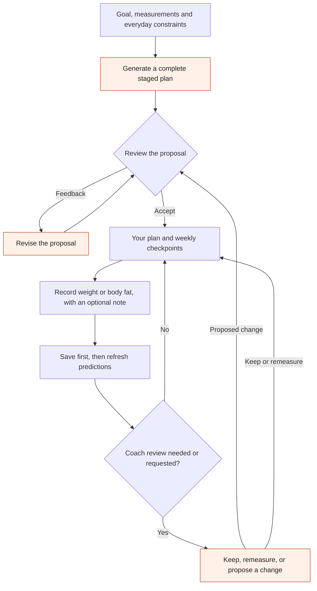
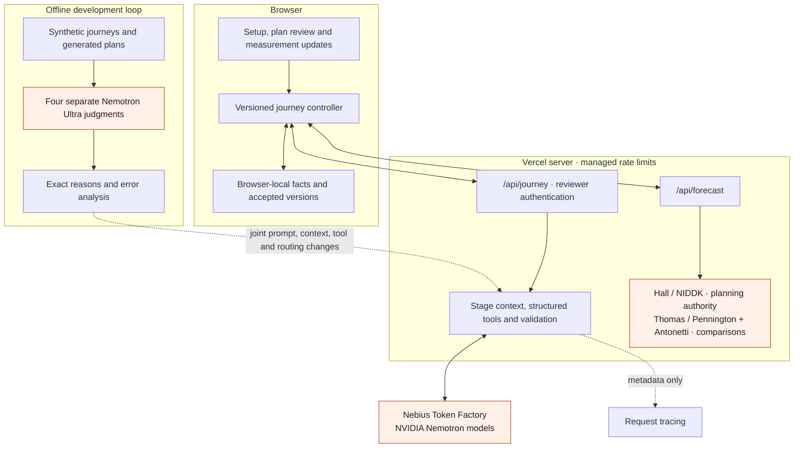

# Adaptive Fat Loss Planner

**A personalized plan that adapts to your progress and everyday life.**

A fat-loss plan needs to keep up with real life. Adaptive connects an AI Agent, research-based weight-prediction models and an evaluation loop to generate a complete plan and reconsider it as measurements or circumstances change.

[Live demo](https://adaptive-fat-loss-planner.vercel.app) · [Run locally](#run-and-verify) · [MIT license](LICENSE)

## Try it

1. Choose **Build my plan** and enter the reviewer code supplied separately.
2. Complete the short setup, review the proposal, give feedback and explicitly accept a version.
3. Update weight/body fat and an optional note. See the refreshed forecast and, when needed or requested, the coach's recommendation.

The [fictional example](https://adaptive-fat-loss-planner.vercel.app/example) is open to everyone and uses scripted advice. The normal planner uses NVIDIA models on Nebius Token Factory. The interface is English; generated plans and coaching follow the user's language.

## The user journey



Initial review allows up to three feedback revisions. A proposal never silently replaces an accepted target. Saved measurements survive AI failure; numerical updates do not wait for an explanation.

## How it works

The controller sequences **interpretation → confirmed parameter mapping → prediction → plan generation**. Later check-ins continue the models from dated observations and conditionally request coaching.



| NVIDIA operation | Deployed model | Thinking |
| --- | --- | --- |
| Interpret setup | `nvidia/Nemotron-3_5-Lightning` | Off |
| Generate / revise a complete plan | `nvidia/Nemotron-3.5-Super-VL` | On |
| Review progress | `nvidia/Nemotron-3.5-Super-VL` | Off |

Ultra judging is offline, outside the customer request path. [Model configuration](config/nemotron-candidate.env.example) · [Stage execution](src/agent/observed-stage.ts) · [Typed workflow](src/domain/workflow.ts)

## What to look for when judging

| [Official criterion](https://nebiusglobalaihackathon.devpost.com/rules) | Demonstrated mechanism and evidence |
| --- | --- |
| Technological implementation | Four NVIDIA-backed operations, deterministic models and validated tools. [Agent implementation](src/agent) |
| Design | One setup → review → accept → check-in loop, with explicit changes and failure recovery. [Controller and recovery](src/application/journey-controller.ts) |
| Potential impact | Lower recording burden for adults pursuing a weight/body-fat goal. Adoption and health outcomes remain unverified. |
| Quality of the idea | Generative planning grounded in dated physiological scenarios, then reconsidered after measurements. [Model sources](THIRD_PARTY_NOTICES.md) |

[Recorded evaluation evidence](docs/evidence/evaluation.json) preserves synthetic cases, original judge verdicts/reasons, actual failures, joint candidate changes and observed costs. Passing judgments are not clinical validation or a claim of equal model quality.

## Run and verify

Requires **Node 22** and **pnpm 10**. Supply your own server-side Token Factory API key.

```sh
pnpm install --frozen-lockfile
cp .env.example .env.local
# Set NEBIUS_API_KEY in .env.local.
pnpm dev:candidate
```

Open http://127.0.0.1:3221. No account is required locally. Persistence is browser-local; inference processes the supplied context server-side. No credentials, model weights or personal sessions are included in this repository.

<details>
<summary>Developer checks and implementation boundaries</summary>

```sh
pnpm test
pnpm typecheck
pnpm exec next build --webpack
```

These checks make no paid model calls. Live evaluation requires separate explicit execution.

- `domain/`: facts and contracts; `planning/`: equations and review policy.
- `agent/`: model-facing stages; `application/`: orchestration, persistence and projections.
- `ui/` and `components/ui/`: experience and official shadcn primitives; `app/`: routes and HTTP.
- Hall owns planning. Antonetti has no body-fat output; the chart's applicable-model mean is descriptive.
- [Judge and rubric](src/evaluation/plan-judge.ts) · [Synthetic cases](src/evaluation/journey-cases.json) · [Design system](DESIGN.md) · [Third-party notices](THIRD_PARTY_NOTICES.md)

</details>

## Hosted reviewer build

The hosted demo uses Vercel Pro, signed reviewer access, server-side credentials and managed rate limits. Reviewers receive their code separately. Self-hosters supply their own credentials; see [.env.example](.env.example), [Vercel configuration](vercel.json) and the optional [Docker build](Dockerfile).

Prototype scope is adults 18–64 within the documented suitability boundary. The equations, application observation policy and prospective health outcomes have separate evidence limits. [Sources and attribution](THIRD_PARTY_NOTICES.md).

<details>
<summary>Prediction assumptions</summary>

Hall/NIDDK is the planning authority. Thomas/Pennington is a version-specific comparison; Modified Antonetti predicts weight only. The chart’s model mean is descriptive. Initial activity/body-composition estimates and future intake/activity assumptions are conditional inputs, not observed adherence. Measurements update an application-level observation policy; they do not identify metabolism or the cause of weight change. No prospective individual accuracy or health outcome is established. Model implementations and their original references are in [planning](src/planning) and [third-party notices](THIRD_PARTY_NOTICES.md).

</details>
